# Material GNOME

<p align="center">
  <a href="https://github.com/SakibShahariar/material-gnome-theme/stargazers">
    
  </a>
  <a href="https://github.com/SakibShahariar/material-gnome-theme/issues">
    
  </a>
  <a href="https://github.com/SakibShahariar/material-gnome-theme/graphs/contributors">
    
  </a>
</p>

A modern, cohesive theme for the GNOME desktop environment inspired by Google's Material You and Material 3 design languages. It provides a unified visual experience across GTK3, GTK4, and GNOME Shell with a focus on deep container colors, expressive active states, and minimal visual clutter.

This theme is the base layer of the [Material-Gnome (Dotfiles)](https://github.com/SakibShahariar/Material-Gnome) wallpaper-driven theming pipeline.

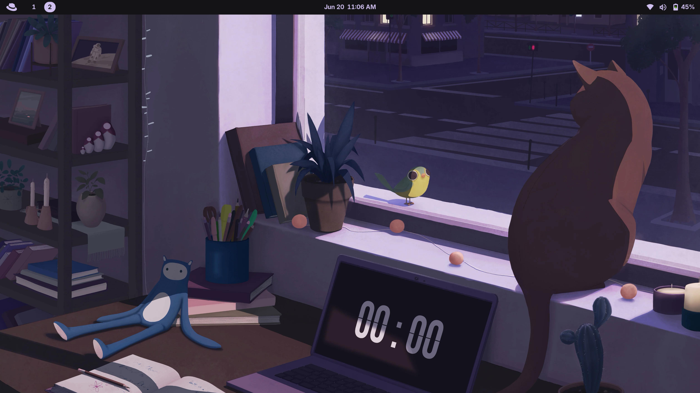

## 📑 Contents

[Screenshots](#screenshots) · [Repository Structure](#repository-structure) · [Features](#features) · [Installation](#installation) · [Flatpak Application Support](#flatpak-application-support) · [Color Themes](#color-themes) · [Top Bar Layouts](#top-bar-layouts) · [Reducing Animations](#reducing-animations) · [Configuration & Tweaks](#configuration--tweaks) · [Acknowledgements](#acknowledgements) · [Feedback & Bug Reports](#feedback--bug-reports) · [License](#license) · [Star History](#star-history)

---

## 🖼️ Screenshots

| App Grid | Quick Settings |
|---|---|
| 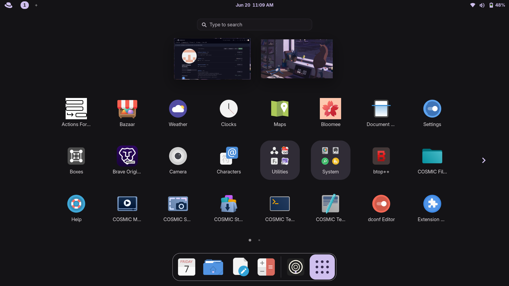 | 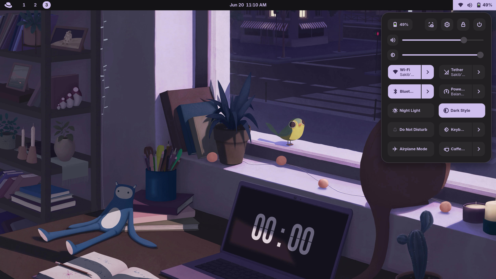 |

| Notifications | Activities Overview |
|---|---|
| 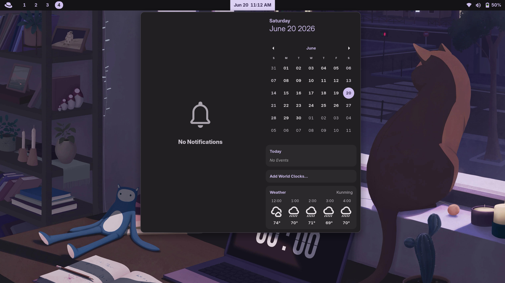 | 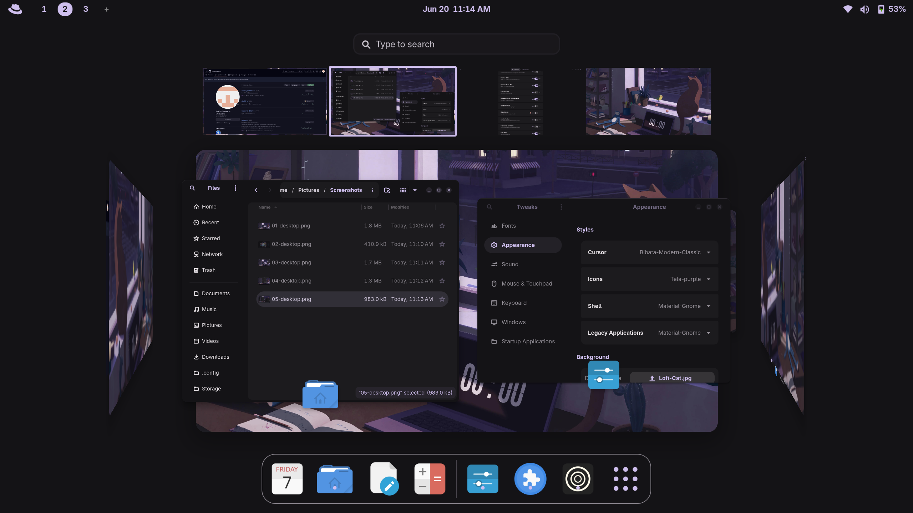 |

| GTK4 App | GTK3 App |
|---|---|
| 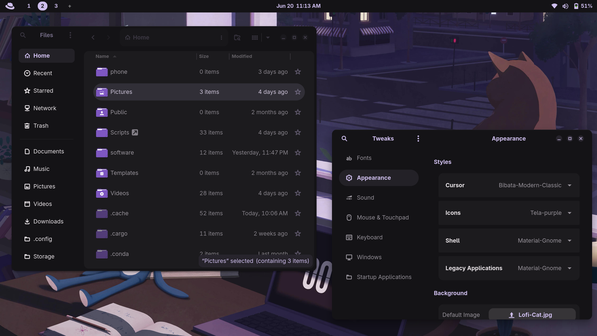 | 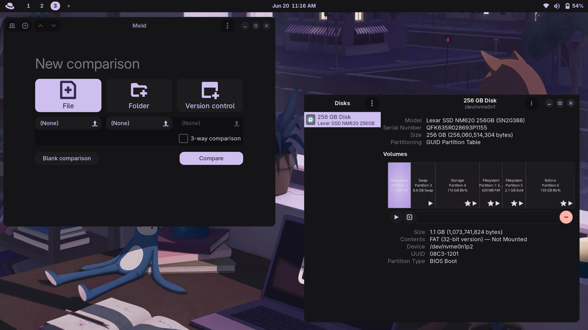 |

---

## 📂 Repository Structure

```text
Material-Gnome/
├── gtk-3.0/         # GTK3 Stylesheet & Assets
├── gtk-4.0/         # GTK4 & Libadwaita Stylesheet
├── gnome-shell/     # GNOME Shell Desktop Theme
│   └── layouts/     # Swappable top bar layout styles
├── themes/          # Premade color themes (applied via Matugen)
├── screenshots/     # Screenshots used in this README
└── index.theme      # Desktop Theme Metadata
```

---

## ✨ Features

* **True System-Wide Consistency:** Unified styling across legacy GTK3 apps, modern GTK4/Libadwaita apps, and the GNOME Shell interface.
* **Material 3 Container Architecture:** Styled with container shapes, adaptive active states, and expressive focus indicators (like the segmented view-switcher design).
* **Self-Contained Color System:** Colors are declared natively per toolkit—making the theme independent, lightweight, and incredibly easy to modify without external dependencies.
* **Dynamic-Ready (Optional):** Completely compatible with color-generation backends like `matugen`.
* **Dark-First Design:** Optimized specifically for modern dark-mode workflows to minimize eye strain.
* **Swappable Top Bar Layouts:** Multiple GNOME Shell top bar styles included — pill, capsule, segmented, unified, and more — so you can pick the look that fits you best.
* **Premade Color Themes:** A set of ready-made color themes is included in `themes/` (JSON color tokens) — apply one by copying values into `colors.css`, no extra tools required.

---

## 🧩 Requirements & Compatibility

- **GTK4 / Libadwaita apps:** GTK **4.16 or newer** is required for the CSS custom properties (`--token` and `var(--token)`) used by this theme. GTK 4.14 and older do not support them and will not render the GTK4 palette correctly. GNOME 47 is the first GNOME release generation with GTK 4.16.
- **GTK3 apps:** Use a GTK3 version supported by your distribution. The theme uses GTK3-specific `@define-color` declarations and does not require GTK4 CSS variables.
- **GNOME Shell:** Shell styling relies on St CSS selectors and properties that can change between GNOME releases. GNOME Shell 50.2 has been reported working with this theme; this is not a guarantee for every Shell version. After a GNOME Shell upgrade, verify the panel layout and overview styling.
- **Libadwaita:** There is no separately enforced minimum libadwaita version. Individual apps may override or ignore parts of a custom GTK stylesheet, and upstream libadwaita does not guarantee compatibility with third-party application theming.

The GTK4 version requirement is based on the [official GTK CSS documentation](https://docs.gtk.org/gtk4/css-properties.html), which documents custom-property support starting with GTK 4.16.

## 🚀 Installation

### 1. Deploy the Theme Files

**Recommended: install from a repository checkout**

Clone the repository, enter its directory, and run the installer. It copies the theme to `~/.themes/Material-Gnome` and links the GTK4 stylesheets, including `colors.css`.

```bash
git clone https://github.com/SakibShahariar/material-gnome-theme.git
cd material-gnome-theme
./install.sh
```

Use `./install.sh --flatpak` if you also want to grant Flatpak applications read-only access to the theme and GTK configuration. Existing regular GTK4 config files are preserved by default; `--force` backs them up before replacing them.

**Manual installation from a release ZIP**

The release archive already contains a `Material-Gnome/` directory:

```bash
mkdir -p ~/.themes
cp -a Material-Gnome ~/.themes/
```

For a system-wide installation, extract the release ZIP and run:

```bash
sudo cp -a Material-Gnome /usr/share/themes/
```

### 2. Enable GNOME Shell Theme Support

GNOME Shell requires the **User Themes** extension to load custom desktop stylesheets.

* **Fedora/RHEL:** `sudo dnf install gnome-tweaks gnome-extensions-app gnome-shell-extension-user-theme`
* **Ubuntu/Debian:** `sudo apt install gnome-tweaks gnome-shell-extension-manager gnome-shell-extension-user-theme`
* **Arch Linux:** `sudo pacman -S gnome-tweaks gnome-shell-extensions`

> 💡 **Note:** Open your system **Extensions** application and ensure the **User Themes** extension is toggled **ON**.

### 3. Apply the Theme

#### GTK3 & GNOME Shell

Open **GNOME Tweaks** and navigate to the **Appearance** tab:

* Set **Legacy Applications** (or Applications) to `Material-Gnome`.
* Set **Shell** to `Material-Gnome`.

#### GTK4 / Libadwaita Applications

Modern Libadwaita apps look into your local user configuration instead of `~/.themes`. To force GTK4 apps to follow your theme, symlink the files into your local configuration directory:

```bash
mkdir -p ~/.config/gtk-4.0
ln -sf ~/.themes/Material-Gnome/gtk-4.0/gtk.css ~/.config/gtk-4.0/gtk.css
ln -sf ~/.themes/Material-Gnome/gtk-4.0/gtk-dark.css ~/.config/gtk-4.0/gtk-dark.css
ln -sf ~/.themes/Material-Gnome/gtk-4.0/colors.css ~/.config/gtk-4.0/colors.css
```

### Optional: Manager App

If you prefer a GUI workflow, [Material GNOME Manager](https://github.com/AdityaHebballe/Material-Gnome-Manager) is a community GTK4/Libadwaita app that can fetch and update the theme, install it locally, apply color presets, generate Matugen palettes, and link GTK4/Libadwaita files automatically.

On Arch Linux, it is also available from the AUR:

```bash
yay -S material-gnome-manager-git
```

---

## 📦 Flatpak Application Support

Flatpak applications run in isolated sandboxes and cannot access your local theme directories by default. Instead of forcing the theme with an environment variable, grant the sandbox read-only access to your theme configs and folders so apps resolve the theme the normal way:

```bash
flatpak override --user --unset-env=GTK_THEME
flatpak override --user --filesystem=xdg-config/gtk-4.0:ro --filesystem=xdg-config/gtk-3.0:ro --filesystem=xdg-data/themes:ro --filesystem=~/.themes:ro
```

The first command clears any previous `GTK_THEME` override so apps fall back to their standard theme resolution. The read-only filesystem grants expose your `gtk-4.0`/`gtk-3.0` configs and installed theme directories, which means:

* **GTK4 / Libadwaita apps** follow the `gtk-4.0` files symlinked above.
* **GTK3 apps** pick up the theme installed in `~/.themes`.

> 💡 **Note:** `--filesystem=xdg-config/...` only works when `XDG_CONFIG_HOME` is the default (`~/.config`).

---

## 🌄 Wallpaper-Driven Workflow

For a wallpaper-based palette, use the recommended flow: **choose a wallpaper in [wallmat](https://github.com/SakibShahariar/wallmat/issues/12) → generate colors with [Matugen](https://github.com/InioX/matugen) → render this theme's GTK3, GTK4, and GNOME Shell stylesheets**. Keep all outputs aligned with the [shared color contract (#73)](https://github.com/SakibShahariar/material-gnome-theme/issues/73). This theme does not require wallmat; presets can also be applied directly with `scripts/apply-theme.py`.

## 🎨 Color Themes

For the shared palette token names, generated files, and Matugen integration contract, see [COLORS.md](COLORS.md).

The `themes/` folder contains a set of premade color themes as JSON files (Material You–style color tokens). A few examples:

| Aqua Abyss | Arctic Blood | Forgotten Atelier |
|---|---|---|
| 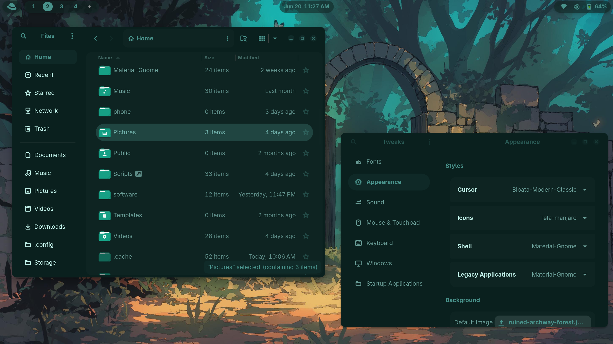 | 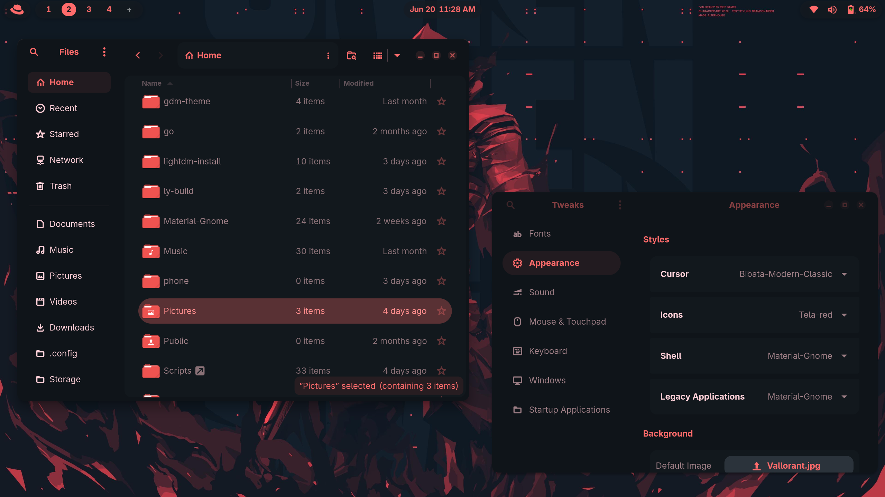 |  |

| Desert Stone | Jade Vineyard |
|---|---|
| 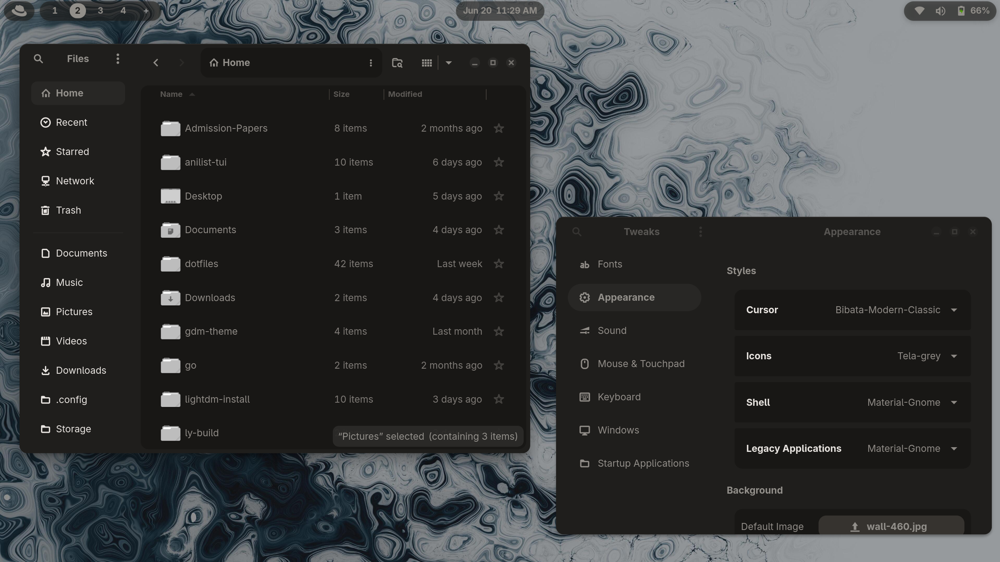 |  |

There are two ways to apply one:

### Option A: Apply a preset with the included script

Render a preset into the GTK3, GTK4, and GNOME Shell stylesheets without installing Matugen:

```bash
# Preview and validate the generated files without changing anything
python scripts/apply-theme.py --dry-run themes/Aqua-Abyss.json

# Apply the preset to all three theme layers
python scripts/apply-theme.py themes/Aqua-Abyss.json
```

The script updates `gtk-3.0/colors.css`, `gtk-4.0/colors.css`, and `gnome-shell/gnome-shell.css` from their corresponding templates. Applying a preset replaces the current generated color files, so keep a backup or commit local customizations first. Restart GTK apps and reload GNOME Shell after applying it.

### Option B: Matugen

[`matugen`](https://github.com/InioX/matugen) is the theme's primary intended color workflow. It can generate a palette from a wallpaper or source color, and it also supports importing a JSON file directly and using its values inside templates — so it can take the same files in `themes/` and output the `colors.css` files for you automatically, no manual copy-pasting required.

---

## 🎨 Top Bar Layouts

GNOME Shell's top bar can be swapped between several included styles. A few examples:

| Floating Capsule | Floating Capsule (Glass) |
|---|---|
| 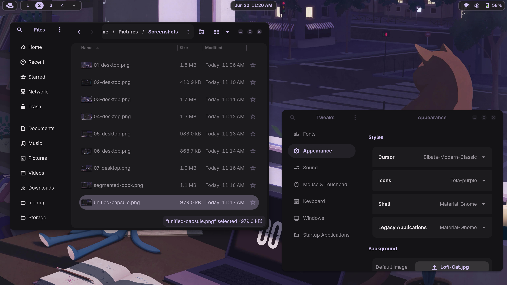 | 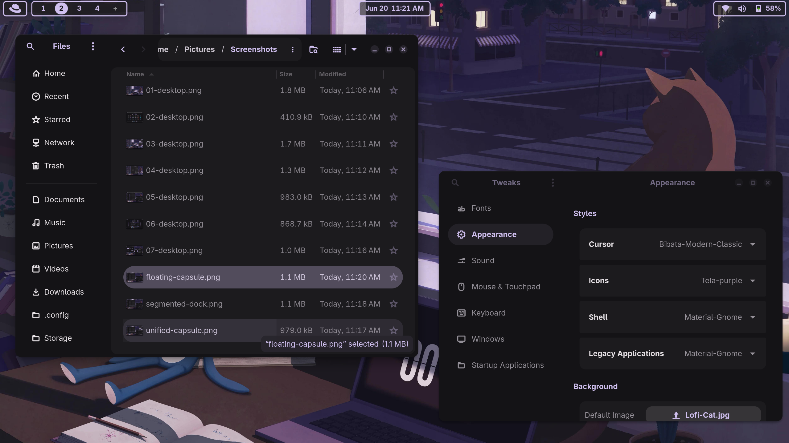 |

| Pill Duo | Unified Capsule | Segmented Dock |
|---|---|---|
| 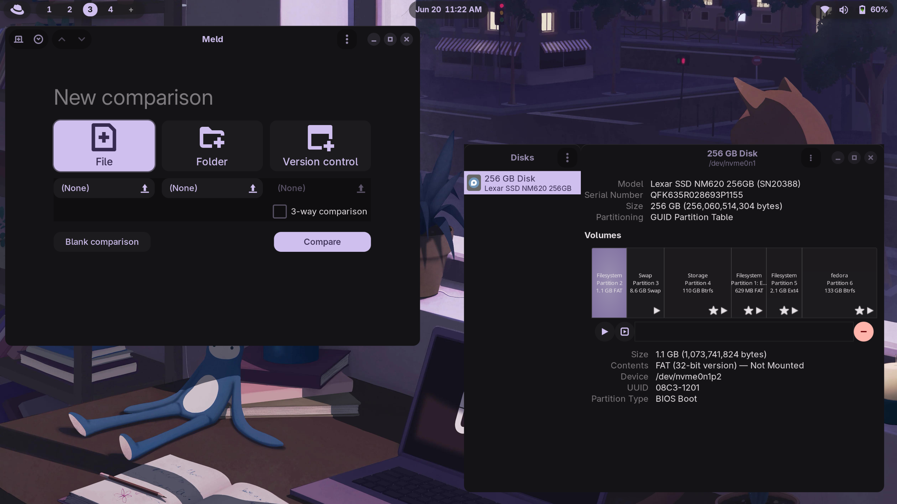 | 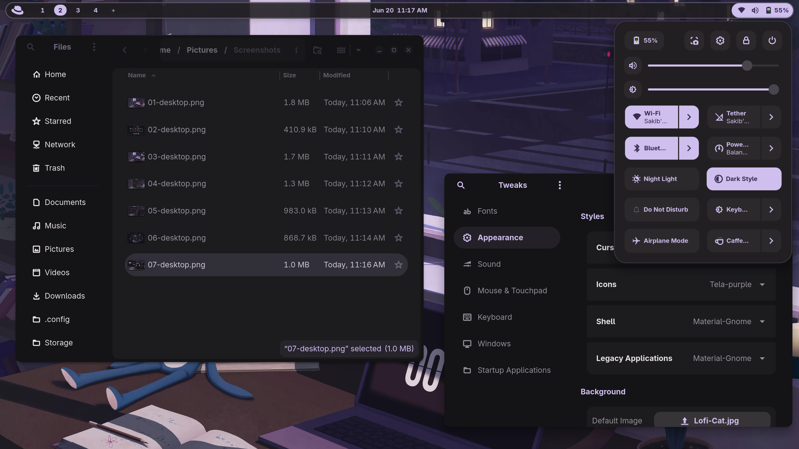 | 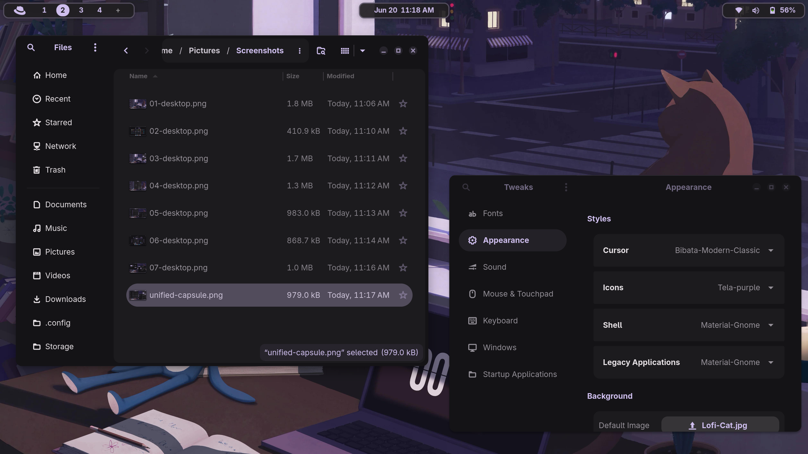 |

Each layout lives as a separate CSS file in `gnome-shell/layouts/`:

```text
gnome-shell/layouts/
├── default.css
├── default-transparency.css
├── active-layout.css
├── floating-capsule.css
├── floating-capsule-glass.css
├── pill-duo.css
├── segmented-dock.css
├── segmented-pill.css
├── structured-box.css
├── unified-bar.css
├── unified-border.css
├── unified-capsule.css
├── unified-capsule-bottom.css
└── unified-pill.css
```

**To apply a layout:**

1. Copy the layout you want over `gnome-shell/layouts/active-layout.css`. For example:

   ```bash
   cp gnome-shell/layouts/unified-pill.css gnome-shell/layouts/active-layout.css
   ```

2. Apply or reinstall the updated theme, then reload GNOME Shell. On Wayland, log out and back in if a shell reload is unavailable.

`gnome-shell/gnome-shell.css` imports `layouts/active-layout.css` at the end, so you no longer need to edit the large generated stylesheet. The checked-in active layout defaults to Floating Capsule (Glass).

---

## 🎬 Reducing Animations

The GTK stylesheets define keyframe animations; `gnome-shell/gnome-shell.css` does not contain `@keyframes` blocks.

To remove the GTK keyframe animations manually, comment out the `@keyframes` blocks in the relevant files:

- GTK3: `gtk-3.0/gtk.css` and `gtk-3.0/gtk-dark.css`
- GTK4 / Libadwaita: `gtk-4.0/gtk.css` and `gtk-4.0/gtk-dark.css`

The paired files are currently identical, so keep both copies in sync. This only removes keyframe animations; other `animation` and `transition` declarations may still animate, and this does not disable GNOME Shell's built-in animations.

---

## 🛠️ Configuration & Tweaks

If you want to tweak or override specific elements (like changing the accent colors), you can modify the primary palette definitions found at the top of the respective stylesheets:

* **GTK3:** `gtk-3.0/colors.css`
* **GTK4/Libadwaita:** `gtk-4.0/colors.css`
* **GNOME Shell:** `gnome-shell/gnome-shell-template.css`

---

## 🙏 Acknowledgements

This project builds on base files from these excellent theme repos by [Fausto-Korpsvart](https://github.com/Fausto-Korpsvart) — credit to the original author:

* [Gruvbox-GTK-Theme](https://github.com/Fausto-Korpsvart/Gruvbox-GTK-Theme)
* [Tokyonight-GTK-Theme](https://github.com/Fausto-Korpsvart/Tokyonight-GTK-Theme)

Both are licensed under GPL-3.0, same as this project.

---

## 🐛 Feedback & Bug Reports

If you run into any bugs, visual glitches, or have suggestions, please [open an issue](../../issues) — feedback is always welcome and helps improve the theme for everyone.

---

## 📜 License

This project is licensed under the **GPL-3.0 License** - see the [LICENSE](LICENSE) file for details.

## Star History

<a href="https://www.star-history.com/?repos=SakibShahariar%2Fmaterial-gnome-theme&type=date&legend=top-left">
 <picture>
   <source media="(prefers-color-scheme: dark)" srcset="https://api.star-history.com/chart?repos=SakibShahariar/material-gnome-theme&type=date&theme=dark&legend=top-left&sealed_token=FzIxZkiD1N-CtDfCfqIIEQ8ZsEPAkie4A15IyPfdtWCPqFuOjplStisTYVgCw2TNHqXt_iIz5GDi05sp4Z0JKFTq27jUtW1rXseVZSdDeMLNp10IRyXaSn93R-NgRJy3Pf0qa7qJWDqt8985J8k91jtjfwnyuKF6q7x3p2sWPj6gua2ZfMOHHKYgNo8U" />
   <source media="(prefers-color-scheme: light)" srcset="https://api.star-history.com/chart?repos=SakibShahariar/material-gnome-theme&type=date&legend=top-left&sealed_token=FzIxZkiD1N-CtDfCfqIIEQ8ZsEPAkie4A15IyPfdtWCPqFuOjplStisTYVgCw2TNHqXt_iIz5GDi05sp4Z0JKFTq27jUtW1rXseVZSdDeMLNp10IRyXaSn93R-NgRJy3Pf0qa7qJWDqt8985J8k91jtjfwnyuKF6q7x3p2sWPj6gua2ZfMOHHKYgNo8U" />
   
 </picture>
</a>
